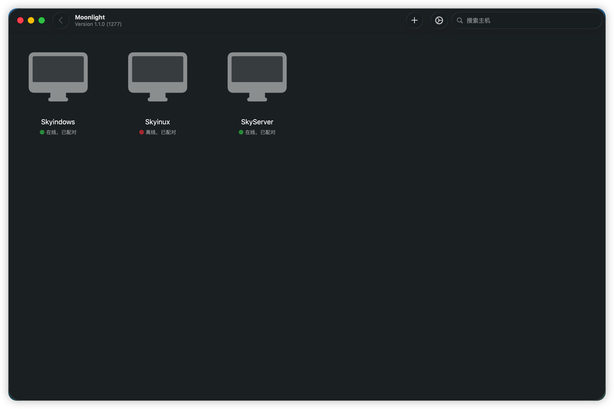
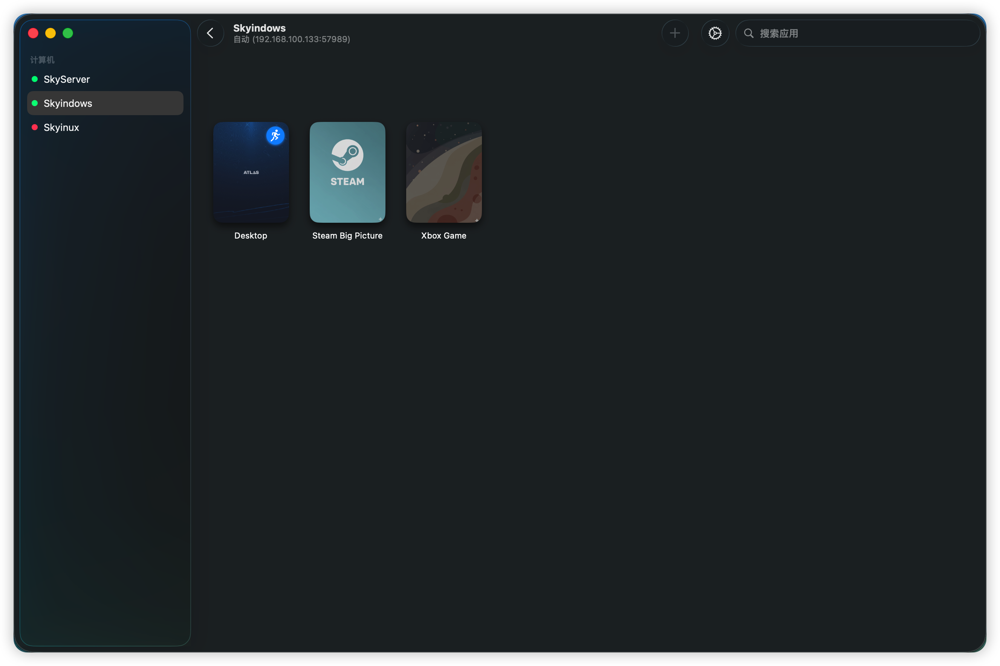
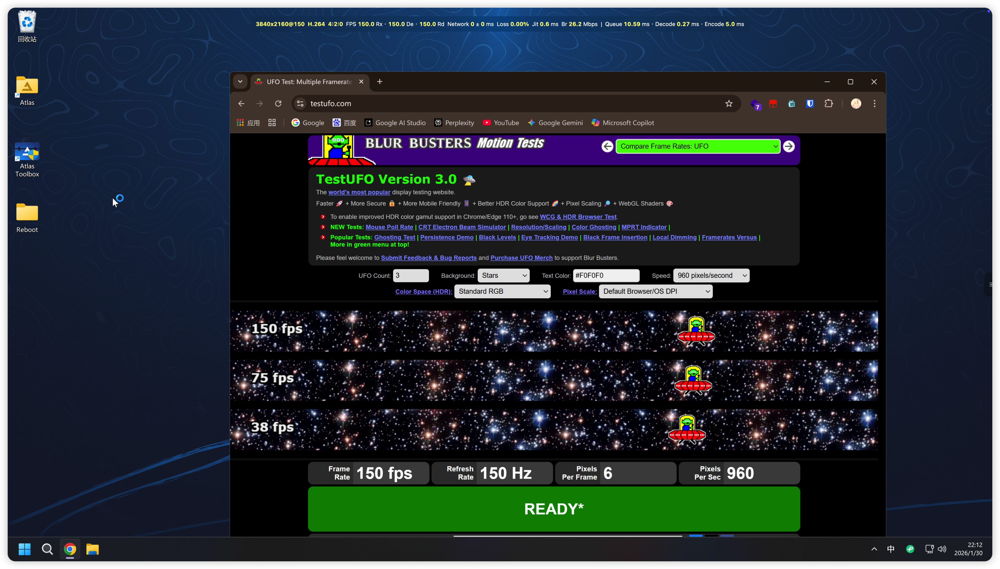
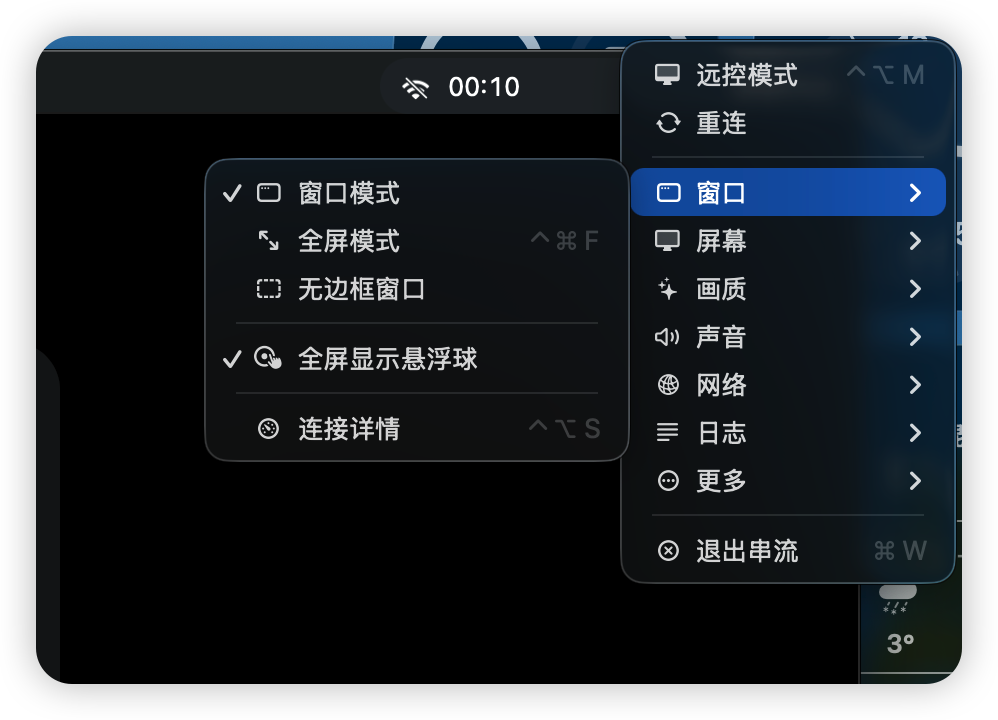
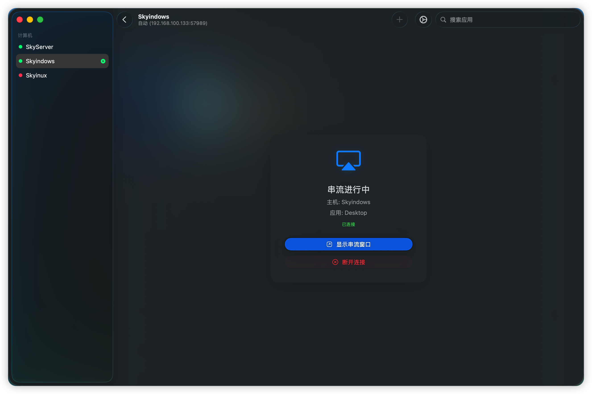
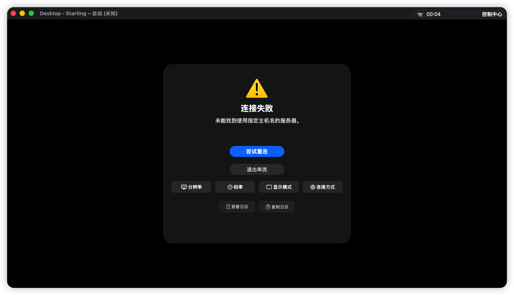

# Moonlight for macOS — Enhanced Edition

[](https://github.com/opsbsligm/moonlight-macos-enhanced/actions/workflows/build.yml)
[](https://github.com/opsbsligm/moonlight-macos-enhanced/releases/latest)
[](https://github.com/opsbsligm/moonlight-macos-enhanced/releases)
[](https://developer.apple.com/macos/)
[](LICENSE)
[](https://github.com/opsbsligm/moonlight-macos-enhanced)

**Moonlight macOS 客户端的独立增强实现** — 本仓库始于 [skyhua0224/moonlight-macos-enhanced](https://github.com/skyhua0224/moonlight-macos-enhanced)（源自 [Moonlight Game Streaming Project](https://github.com/moonlight-stream)），自 2026-10 起完全独立，不再与任何上游同步。原始上游作者的 PR 已被拒，本仓库锁定 fork 链路后独立演进。

**一句话差异**：把键盘/鼠标输入做成与 Parsec、UU 远程、Steam Link 同一套工业标准映射并让它可测试、可诊断，其余能力（编解码、HDR、音频、手柄）在此之上持续增强。映射表、设计原则与已修复问题的根因见 [`docs/input-mapping-design.md`](docs/input-mapping-design.md)，逐项对标结论见 [`docs/input-mapping-benchmark.md`](docs/input-mapping-benchmark.md)。

## 能做什么

- **串流核心**：GameStream / Sunshine 主机发现与配对；H.265/HEVC & AV1 硬件解码；HDR 支持与多策略 HDR→SDR tone mapping（含 `No Exposure Shift` 档）；多声道音频 + 麦克风传输
- **视频增强管线**：MetalFX 超分与缩放（画质/性能/关闭三档）、VideoToolbox 低延迟插帧、**强制插帧**（绕过显示器刷新率 ≥2× 串流帧率的限制，以 4:2:0 源换取插帧生效）、运行时可观测的渲染路径/引擎挂载状态
- **输入系统**：Core HID 高精度鼠标（锁鼠/自由鼠标双模式）、工业标准键盘映射（对标 Parsec/UU 远程/Steam Link）全量修复、虚拟 Xbox 360 手柄（含 Xbox Elite 2 / Betop Zeus 等设备识别修正）、剪贴板同步
- **串流中控制栏（边缘把手）**：四边可拖拽停靠的把手（收起态 14×48pt），智能点亮/点击展开/快捷键唤起，支持锁定鼠标态通过快捷键（⌃⌥C）开闭侧边栏，不估算远端光标位置；自动超时归位
- **性能诊断**：实时性能叠加层、视频管线运行时状态面板、输入诊断记录器、完整诊断报告导出（一键拷贝）
- **USB 设备诊断页**：列出本机 USB 总线设备，归因到具体原因（保留类别/本地输入设备/未匹配规则/前置条件），报告签名能否加载驱动扩展，主机声明读成四态（支持/不支持/无法到达/未问过）
- **界面**：中英双语（菜单、权限弹窗、日志面板、首页卡片均为本地化）、macOS 27 Liquid Glass 磨砂玻璃设计语言，活动监视器式原生页签导航
- **质量门禁**：60+ 条行为约束审计（内存泄漏、引用循环、键盘冲突、资源释放、build 警告等），每道门禁带自证诱饵

## 当前边界（不能做什么）

- **USB 设备重定向**：设备诊断页已实现，但重定向传输层尚需 Developer ID 签名（$99/年 Apple Developer Program）与主机侧虚拟总线 DriverKit 驱动，两者均未到位，不承诺交接成功（取舍见 [`docs/usb-redirection-design.md`](docs/usb-redirection-design.md)）
- **macOS 26.0+ 运行时**：`MACOSX_DEPLOYMENT_TARGET = 26.0`，Liquid Glass 窗口层依赖该版本
- **Ad-hoc 签名**：每个构建需首次运行时在"系统设置 → 隐私与安全性"中允许运行；已公证的 Developer ID 构建暂时不可用
- **插帧/超分实机验收**：视频增强管线架构已完备，但 90fps 动态插帧在实机串流场景下的端到端体验还需持续打磨

### 主机兼容性

| 主机软件 | 兼容性 | 说明 |
|----------|--------|------|
| [Foundation Sunshine](https://github.com/qiin2333/foundation-sunshine) | ⭐ 推荐 | 麦克风上行、YUV 4:4:4、多声道音频、双向剪贴板（文字+单图）最佳支持 |
| [Sunshine (LizardByte)](https://github.com/LizardByte/Sunshine) | ✅ 支持 | 多数功能可用，部分高级路径受限 |
| GeForce Experience | ⚠️ 基础 | 已弃用，缺少麦克风上行等新特性 |

## 下载与安装

1. 从 [Releases](https://github.com/opsbsligm/moonlight-macos-enhanced/releases/latest) 下载最新镜像：`Moonlight-macOS-Enhanced-{arm64,x86_64,universal}.dmg`，每个都附带同名 `.sha256`
2. 打开 DMG，将 `MoonlightEnhanced.app` 拖入 Applications（访达中显示为"Moonlight 增强版"）
3. 首次运行时，在"系统设置 → 隐私与安全性"中允许运行

> ℹ️ 本构建的 bundle 名是 `MoonlightEnhanced.app`，与 Qt 客户端的 `Moonlight.app` 不会互相替换（issue #41），两者可以并存。若 `/Applications` 里还留着早期版本装的 `Moonlight.app`，请先删除它：两者 bundle 标识符相同（`std.skyhua.MoonlightMac2`），同时存在时 LaunchServices 可能仍启动旧的那一份。

## 快速开始（从源码构建）

```bash
git clone --recurse-submodules <repo-url>
cd moonlight-macos-enhanced
scripts/download-frameworks.sh   # 首次构建前必须执行
scripts/build.sh                 # 或 Xcode 直接构建
scripts/package-dmg.sh
```

首次构建前必须执行 `scripts/download-frameworks.sh`，否则 common-c 编译失败。Xcode 与 deployment target 要求见 [`docs/contributing.md`](docs/contributing.md)。

## 如何反馈

1. **先拷贝诊断报告。** `设置 → 应用 → 调试日志 → 拷贝诊断报告…` 会把一份可直接粘贴的报告放进剪贴板；配对失败的弹窗里也有同一个按钮。
2. **如果问题是鼠标不动，请先打开 `设置 → 应用 → 调试日志 → 输入诊断（Input Diagnostics）` 再复现一次，然后拷贝报告。**
3. 在此基础上请补充：主机端软件与版本、是否启用 Mos/BetterMouse/SteerMouse 等第三方鼠标工具、复现步骤与期望结果。

报告字段说明与脱敏方法见 [`docs/diagnostics-report.md`](docs/diagnostics-report.md)。

## 文档

全部文档的读者与目的见 [`docs/README.md`](docs/README.md)。逐轮变更记录见 [`CHANGELOG.md`](CHANGELOG.md)；历史归档见 [`docs/history/rounds.md`](docs/history/rounds.md)。

## 贡献

Fork → 特性分支 → [Conventional Commits](https://www.conventionalcommits.org/) → PR。
质量门控清单（60+ 行为约束门禁，每道带自证诱饵）、Commit 类型与版本号/tag 约定见 [`docs/contributing.md`](docs/contributing.md)。CI/CD：每次 push 自动跑构建+全部门禁，发布前跑 release-gate 总闸。

## 截图

| 首页（主机列表） | 设置 - 输入 |
|:----------------:|:----------:|
|  |  |

| 性能叠加层 | 串流控制栏 |
|:----------:|:----------:|
|  |  |

| 串流叠加层 | 连接错误 |
|:----------:|:--------:|
|  |  |

## 许可证

本项目基于 [GPL-3.0](LICENSE) 许可证发布。

包含的第三方组件：
- moonlight-common-c (GPLv3) — Git 子模块
- OpenSSL (Apache 2.0)
- FFmpeg (LGPLv2.1+)
- SDL2 (zlib)
- MASPreferences (BSD-2-Clause)
- Roboto Font (Apache 2.0)

## 致谢

- [Moonlight Game Streaming Project](https://github.com/moonlight-stream) — 原始上游项目
- [skyhua0224/moonlight-macos-enhanced](https://github.com/skyhua0224/moonlight-macos-enhanced) — 历史起点（已独立）
- [opsbsligm/moonlight-macos-enhanced](https://github.com/opsbsligm/moonlight-macos-enhanced) — 当前独立主仓库
- [Parsec](https://parsec.app) — 键盘映射最佳实践参考
- 所有贡献者与测试用户
